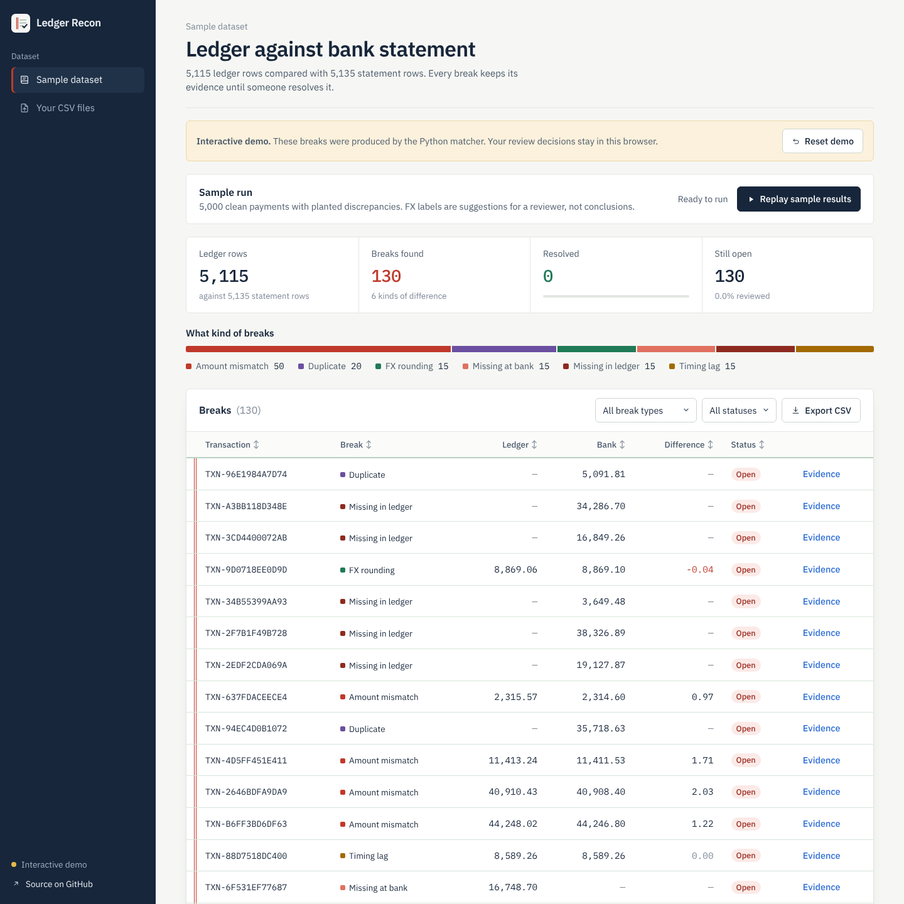
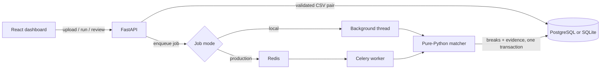

# Ledger Recon

[](https://github.com/Wali05/ledger-recon/actions/workflows/ci.yml)

A reconciliation workbench that compares an internal ledger with a bank statement, classifies every discrepancy with traceable evidence, and records who resolved what, when and why.

**Python · FastAPI · SQLAlchemy · Alembic · PostgreSQL / SQLite · Celery + Redis · React · Vite**



## At a glance

| | |
| --- | --- |
| **Sample run** | 5,115 ledger rows vs 5,135 statement rows → 130 classified breaks |
| **Accuracy (synthetic labels)** | Micro F1 **0.885**; weakest class reported, not hidden (`FX_ROUNDING` F1 0.571) |
| **Scale** | 10,000 × 10,000 rows with every ID mangled: fuzzy fallback in **~0.1 s** (full scan ~9 s) |
| **Idempotency** | Unchanged rerun: 130 breaks detected, **0 inserted**, every resolution kept |
| **Review trail** | API-key sign-in names the reviewer; every resolve/reopen is an append-only event with an optional note |
| **Tests** | 80 backend tests on **both SQLite and PostgreSQL**, browser tests on desktop + mobile, CI on every push |

## How it works



The matcher runs in four ordered passes:

1. **Duplicates** – every extra occurrence of a transaction ID in either feed becomes a `DUPLICATE`.
2. **Exact ID pairs** – amount differences are classified first, then date differences.
3. **Fuzzy fallback** – unmatched rows are paired with the nearest statement row within ±0.50 and 3 days, using an amount-sorted index (binary search, not a full scan).
4. **Leftovers** – unpaired rows become `MISSING_EXTERNAL` or `MISSING_INTERNAL`.

| Break | Meaning |
| --- | --- |
| `AMOUNT_MISMATCH` | Paired amounts differ |
| `FX_ROUNDING` | Non-zero difference ≤ 0.05 on a non-USD ledger row (a hypothesis for review) |
| `TIMING_LAG` | Same amount, dates 1–3 UTC days apart |
| `MISSING_EXTERNAL` / `MISSING_INTERNAL` | Row exists on one side only |
| `DUPLICATE` | Extra occurrence of an ID |
| `UNKNOWN` | Pair the rules cannot explain (e.g. dates > 3 days apart) |

Every break stores both amounts, both timestamps, the partner ID and the rule that fired, so a reviewer can see *why* before marking it resolved. Decisions can be reopened, and each one lands in the break's review history.

## Engineering decisions

- **Money is exact.** `Decimal` end to end; `NUMERIC(18,4)` in PostgreSQL, scaled integers in SQLite, decimal strings in JSON. The browser never turns an amount into a float.
- **Reruns are idempotent.** Each break has a stable key (transaction, type, side, occurrence). Inserts use `ON CONFLICT DO NOTHING`, so resolutions and original detection times survive reruns and task redelivery.
- **One job per dataset.** A dataset row lock plus a partial unique index stop two runs, or an upload and a run, from racing.
- **All-or-nothing results.** A worker publishes breaks and marks the job complete in a single transaction; a failed run leaves no partial results.
- **Strict input.** Both CSVs are fully validated before anything is replaced. Errors name the line; duplicate rows are kept so the matcher can see them.
- **Accountable review.** Optional `API_KEYS` (`reviewer:key` pairs) put every data endpoint behind a bearer key, compared in constant time. Resolve/reopen write an append-only event in the same transaction; events keep a copy of the break's identity, so history outlives a replaced dataset.
- **Versioned schema.** Alembic migrations, including a tested upgrade from the old unversioned schema that preserves resolutions.
- **AI is advisory only.** Optional Gemini explanations are cached text; they never classify, resolve or change data.

More detail: [architecture and trade-offs](docs/architecture.md) · [verification log](docs/verification.md).

## Run it

**1. Interactive demo (no backend).** Uses real matcher output stored as a snapshot; review state stays in your browser.

```sh
cd frontend
npm ci
npm run dev:demo
```

**2. Full app, zero infrastructure** (SQLite + background threads). Python 3.12, Node 22+.

```sh
python -m venv .venv
.venv\Scripts\Activate.ps1          # macOS/Linux: source .venv/bin/activate
pip install -r backend/requirements.txt
uvicorn app.main:app --app-dir backend --reload
```

To require sign-in, set `API_KEYS=alice:<long-random-key>` before starting the API; the dashboard will ask for the key.

Then in a second terminal: `cd frontend && npm ci && npm run dev`, open http://localhost:5173 and click **Run reconciliation**. API docs: http://localhost:8000/docs. To try uploads, pick **Your CSV files** and use [`samples/ledger.csv`](samples/ledger.csv) and [`samples/statement.csv`](samples/statement.csv).

**3. Production-shaped stack** (PostgreSQL 16, Redis 7, API, Celery worker, dashboard):

```sh
docker compose up --build --wait
```

**Deploy the demo to Vercel:** import the repo, set **Root Directory = `frontend`**, framework Vite, no environment variables. Details and the hosted-API option: [deployment guide](docs/deployment.md).

## API at a glance

Interactive documentation is served at `/docs` when the API runs.

| Method | Path | Purpose |
| --- | --- | --- |
| `POST` | `/reconcile/upload` | Validate and store a ledger + statement CSV pair |
| `POST` | `/reconcile/run?source=` | Queue a reconciliation job (`synthetic` or `uploaded`) |
| `GET` | `/reconcile/status/{job_id}` | Job progress and totals |
| `GET` | `/breaks` | Filter, sort and page breaks |
| `GET` | `/breaks/export` | Download the filtered breaks as CSV |
| `POST` | `/breaks/{id}/resolve` | Mark a break resolved, with an optional note |
| `POST` | `/breaks/{id}/reopen` | Reopen a resolved break, with an optional note |
| `GET` | `/breaks/{id}/events` | Review history for one break |
| `GET` | `/audit?source=` | Recent review history for a dataset |
| `GET` | `/stats` | Totals and break counts by type |
| `GET` | `/session` | Whether sign-in is required, and who is signed in (public) |
| `GET` | `/health` | Database liveness check (public) |

## Tests

```sh
pip install -r backend/requirements-dev.txt
pytest backend/tests                  # matcher, API, migrations (SQLite)
python scripts/evaluate_standalone.py # precision / recall / F1 per break type
cd frontend && npm test && npm run build && npm run test:browser
```

Set `TEST_DATABASE_URL` to run the same backend suite against PostgreSQL ([how](docs/verification.md#reproduce-postgresql-checks)). CI runs both databases, lint, formatting, the demo build and the browser tests.

## Project structure

```text
backend/
  app/engine/      pure matching + evaluation (no DB, no network)
  app/services/    CSV validation, dataset replacement and locking
  app/api/         HTTP endpoints (upload, run, breaks, stats, export)
  app/auth.py      optional API-key sign-in and reviewer identity
  app/tasks.py     transactional reconciliation job
  migrations/      Alembic schema versions
  tests/           matcher, API and migration tests
frontend/
  src/components/  dashboard components
  src/demo/        snapshot + browser-only adapter for the public demo
  tests/           unit and Playwright browser tests
samples/           small ledger and statement CSVs for trying uploads
scripts/           demo snapshot builder, evaluation, smoke test
docs/              architecture, deployment, verification
```

## Scope

This is an engineering prototype on synthetic data. Access control is shared API keys for one trusted team: no SSO, roles or multi-tenant isolation. It keeps one uploaded dataset at a time, and its tolerances are illustrative rather than a bank's settlement policy. The statement format carries no currency, so both feeds must already be in comparable units. Accuracy has only been measured on synthetic labels; a real deployment would need independently labelled data first.
