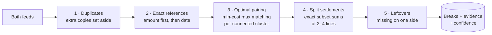
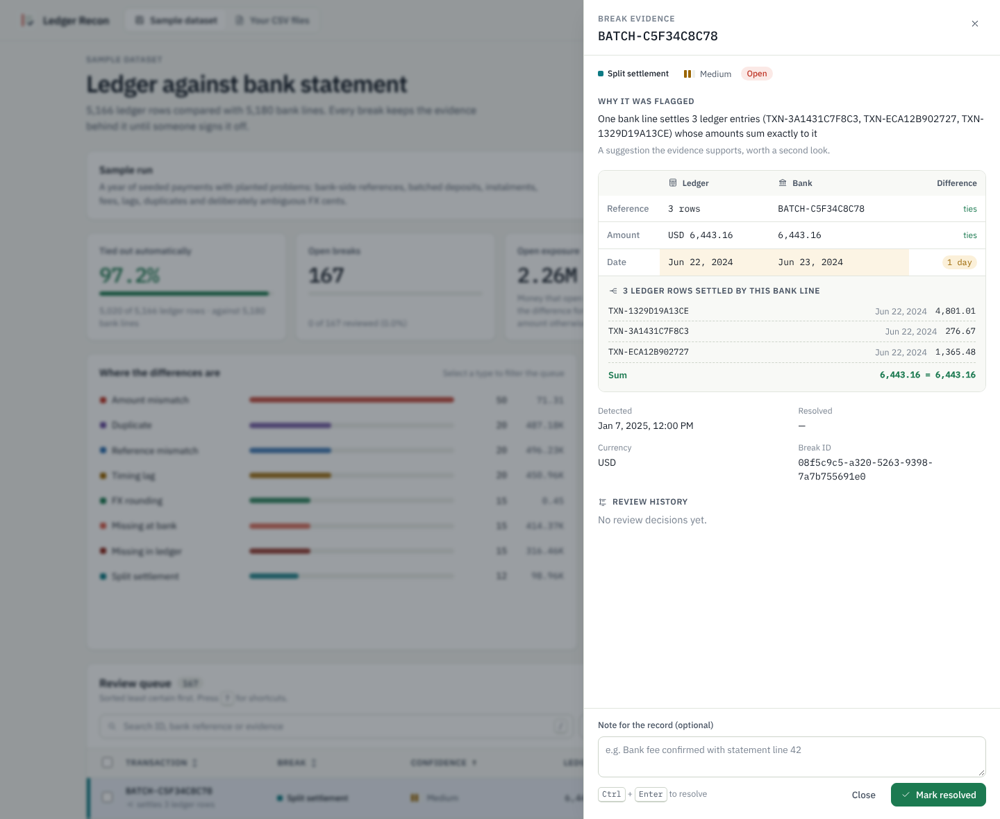
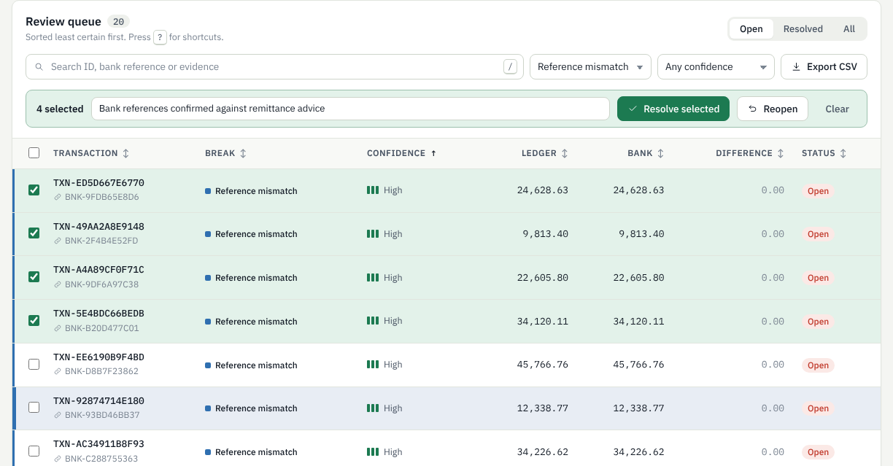
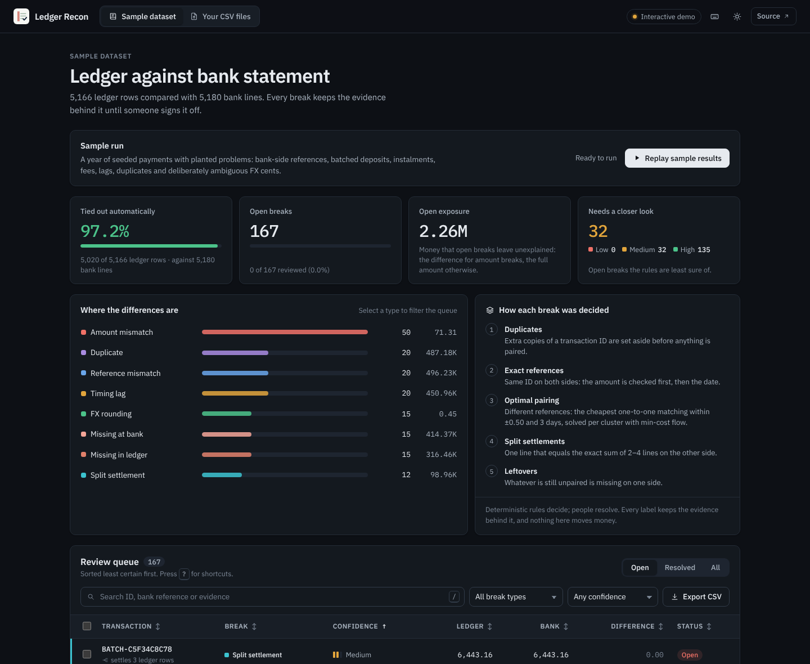

<div align="center">


# Ledger Recon

**Bank reconciliation that shows its working.**<br />
Compares an internal ledger with a bank statement, explains every difference with evidence, and records who signed each one off.

[](https://github.com/Wali05/ledger-recon/actions/workflows/ci.yml)


[**Live demo**](https://wali05.github.io/ledger-recon/) · [How it decides](#how-it-decides) · [Architecture](docs/architecture.md) · [Verification log](docs/verification.md)


</div>

## Why this exists

Every month-end, finance teams line up what their books say against what the bank says. Most of it ties. The rest is where the time goes: a deposit that bundles three card settlements, a payment booked on Friday that cleared on Monday, a bank fee nobody recorded, a statement that uses the bank's own reference instead of yours. Spreadsheets find the rows that differ; they don't say *why*, and they don't remember who decided what.

Ledger Recon does the matching with deterministic rules, labels each difference with the evidence behind it, ranks the queue by how sure the rules are, and keeps an append-only record of every decision. It never moves money and never lets a model make the call.

## Results on the sample data

The bundled dataset is a seeded year of 5,166 ledger rows and 5,180 bank lines with 167 planted problems, including the hard ones: bank-side references, batched deposits, instalment payments and deliberately ambiguous FX cents.

| | Previous engine (greedy, 1:1 only) | **Current engine** |
| --- | --- | --- |
| Items a reviewer has to open | 201 | **167** |
| Micro F1 against the planted labels | 0.652 | **0.910** |
| Batched deposits and instalments recognised | 0 of 12 | **12 of 12** |
| Bank-reference payments paired | labelled `UNKNOWN` | **20 of 20 as reference mismatches** |
| Ledger rows that tie out with no review | — | **97.2%** (5,020 of 5,166) |

The weakest class is reported rather than hidden: `FX_ROUNDING` scores F1 0.571 because the generator plants cases that are indistinguishable from fees on the available columns. Both engines were scored on the same regenerated data; how to reproduce is in the [verification log](docs/verification.md).

## What it catches

| Break | Meaning | Default confidence |
| --- | --- | --- |
| `AMOUNT_MISMATCH` | Paired rows disagree on the amount (fees, short payments) | high |
| `FX_ROUNDING` | A non-zero difference ≤ 0.05 on a foreign-currency ledger row, offered as a hypothesis | medium |
| `TIMING_LAG` | Same amount, booked 1–3 calendar days apart | high |
| `REFERENCE_MISMATCH` | Same amount and day, but the bank used its own reference | high when unique |
| `SPLIT_SETTLEMENT` | One line equals the exact sum of 2–4 lines on the other side | medium |
| `MISSING_INTERNAL` / `MISSING_EXTERNAL` | On one side only | high, medium if a near candidate was taken |
| `DUPLICATE` | An extra copy of a transaction ID | high, medium if the copy's amount differs |
| `UNKNOWN` | A pair the rules cannot explain, such as dates more than 3 days apart | low |

Confidence drops to **low** whenever several rows compete for the same partner or a second combination also fits. The queue opens on those first.

## How it decides



**Optimal pairing, not first come first served.** Rows whose IDs don't line up are paired on amount (±0.50) and date (±3 days). The obvious way to do that is greedy, and greedy has a failure mode that real data hits:

```text
ledger  A 100.20    B 100.00          greedy:  A→X (closest), B has nothing in range → 2 false "missing"
bank    X 100.10    Y 100.60          optimal: A→Y, B→X → both paired
```

The candidate graph is split into connected components, and each one is solved as a minimum-cost maximum matching using successive shortest paths with Johnson potentials. Cost is lexicographic (cents first, then days). A test enumerates every possible assignment on 40 random dense cases and checks the engine always finds the true optimum; another checks it never pairs fewer rows than greedy. With 10,000 rows per side and every ID mangled, this pass takes about 0.1 s.

**Split settlements.** After pairing, each leftover line is checked against the leftover lines on the other side: same sign, same ledger currency, within the date window, summing *exactly* to it. The search prefers the fewest parts, stops as soon as the smallest remaining amounts overshoot or the largest can't reach, and looks at no more than the 24 nearest-dated candidates found in a date-sorted index. If a second combination also fits, the label stays but confidence drops to low and the evidence says so. Two unrelated 10,000-row files (the worst case) finish in about 1.3 s.

**Evidence, not verdicts.** Every break stores both amounts, both timestamps, the partner reference, the rule that fired, a confidence tier and, for splits, each member line with its amount and date. The reviewer sees exactly what the engine saw.

## The review workflow

<table>
  <tr>
    <td width="50%"></td>
    <td width="50%"></td>
  </tr>
  <tr>
    <td><b>Evidence drawer.</b> Ledger and bank side by side with the cells that disagree marked. Split settlements list each member line and the running sum.</td>
    <td><b>Review queue.</b> Least certain first. Search IDs, bank references or evidence text; filter by type, confidence and status; resolve a batch with one note.</td>
  </tr>
</table>

- **Overview**: share of ledger rows that tied out automatically, open breaks, open exposure (the money still unexplained) and how many open breaks the rules are unsure of.
- **Keyboard review**: <kbd>/</kbd> search, <kbd>j</kbd>/<kbd>k</kbd> move, <kbd>Enter</kbd> open, <kbd>x</kbd> select, <kbd>Ctrl</kbd>+<kbd>Enter</kbd> resolve, <kbd>?</kbd> for the list.
- **Accountable decisions**: resolve and reopen take a note; each change writes an append-only event naming the reviewer, in the same transaction.
- **Light and dark themes**, a phone layout with no horizontal scrolling, and CSV export that follows the current filters.

<p align="center"></p>

## Engineering decisions

- **Money is exact.** `Decimal` end to end; `NUMERIC(18,4)` in PostgreSQL, scaled integers in SQLite, decimal strings in JSON. The browser sums and compares amounts as `BigInt`s and never turns one into a float.
- **Reruns are idempotent and self-correcting.** Each break has a stable key (transaction, type, side, occurrence). A rerun upserts: review state, IDs and first-detection times are kept, the evidence is refreshed, and breaks the current rules no longer produce are retired while their history stays.
- **One job per dataset.** A dataset row lock plus a partial unique index stop two runs, or an upload and a run, from racing.
- **All-or-nothing results.** A worker publishes breaks and completes the job in one transaction; a failed run leaves no partial results.
- **Strict input.** Both CSVs are validated line by line before anything is replaced. Duplicate rows are kept so the matcher can see them.
- **Accountable review.** Optional `API_KEYS` (`reviewer:key` pairs) put every data endpoint behind a bearer key compared in constant time. Bulk review uses the same conditional write as a single review, so only real changes add events.
- **Versioned schema.** Three Alembic migrations, including a tested upgrade from the original unversioned schema that preserves resolutions. A test compares the migrated schema with the models on both databases.
- **AI is advisory only.** Optional Gemini explanations are cached text. They never classify, resolve or change data.

More in [architecture and trade-offs](docs/architecture.md).

## Run it

**1. The demo, no backend.** Real matcher output stored as a snapshot; review decisions stay in your browser. Hosted at **[wali05.github.io/ledger-recon](https://wali05.github.io/ledger-recon/)**, or locally:

```sh
cd frontend && npm ci && npm run dev:demo
```

**2. Full app, zero infrastructure** (SQLite and background threads). Python 3.12, Node 22+.

```sh
python -m venv .venv
source .venv/bin/activate              # Windows: .venv\Scripts\Activate.ps1
pip install -r backend/requirements.txt
uvicorn app.main:app --app-dir backend --reload
```

In a second terminal: `cd frontend && npm ci && npm run dev`, open http://localhost:5173 and select **Run reconciliation**. API docs are at http://localhost:8000/docs. To try uploads, choose **Your CSV files** and use [`samples/ledger.csv`](samples/ledger.csv) and [`samples/statement.csv`](samples/statement.csv). Set `API_KEYS=alice:<long-random-key>` before starting the API to require sign-in.

**3. Production-shaped stack** (PostgreSQL 16, Redis 7, API, Celery worker, dashboard):

```sh
docker compose up --build --wait
```

Hosting options (GitHub Pages, Vercel, a hosted API on Render with Neon) are in the [deployment guide](docs/deployment.md).

## API

Interactive documentation is served at `/docs`.

| Method | Path | Purpose |
| --- | --- | --- |
| `POST` | `/reconcile/upload` | Validate and store a ledger + statement CSV pair |
| `POST` | `/reconcile/run?source=` | Queue a reconciliation job (`synthetic` or `uploaded`) |
| `GET` | `/reconcile/status/{job_id}` | Progress and totals: detected, inserted, retired |
| `GET` | `/breaks` | Filter (`break_type`, `resolved`, `confidence`, `q`), sort and page |
| `GET` | `/breaks/export` | The same filtered view as CSV |
| `POST` | `/breaks/{id}/resolve` · `/reopen` | Review one break, with an optional note |
| `POST` | `/breaks/bulk-review` | Resolve or reopen up to 500 breaks with one note |
| `GET` | `/breaks/{id}/events` · `/audit` | Review history for a break or a dataset |
| `GET` | `/stats` | Counts, open exposure by type, confidence mix, auto-tied rows |
| `GET` | `/session` · `/health` | Sign-in requirement and liveness (public) |

## Tests

```sh
pip install -r backend/requirements-dev.txt
pytest backend/tests                     # 136 tests: matcher, API, auth, migrations
python scripts/evaluate_standalone.py    # precision / recall / F1 per break type
cd frontend && npm test && npm run build && npm run test:browser
```

CI runs the backend suite on **SQLite and PostgreSQL 16**, lint and formatting for both halves, a check that the committed demo snapshot matches the current matcher, the frontend unit tests, and Chromium tests of the built demo on desktop and mobile. `npm run test:connected` drives the same UI against a live API.

## Project structure

```text
backend/
  app/engine/      pure matching and evaluation (no database, no network)
  app/services/    CSV validation, dataset replacement and locking
  app/api/         HTTP endpoints
  app/tasks.py     transactional reconciliation job
  migrations/      Alembic schema versions
  data/            seeded generator and the bundled sample feeds
frontend/
  src/components/  overview, review queue, evidence drawer
  src/demo/        snapshot and browser-only API adapter for the public demo
  tests/           unit and Playwright browser tests
scripts/           demo snapshot builder, evaluation, smoke test
docs/              architecture, deployment, verification
```

## Limits, stated plainly

This is an engineering project on synthetic data. I wrote both the generator and the rules, so the scores above show the engine does what it was designed to do; they are not an independent accuracy measure, and a real deployment would need independently labelled data first. Tolerances are illustrative, not a bank's settlement policy. The statement format carries no currency, so both feeds must already be in comparable units. Access control is shared API keys for one trusted team: no SSO, roles or tenant isolation, and one uploaded dataset at a time.

## License

[MIT](LICENSE)
