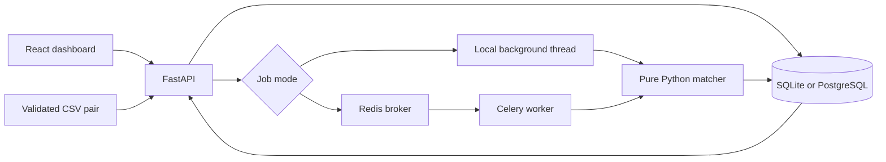

# Architecture and decisions

Ledger Recon is a portfolio reconciliation workbench. The engine compares two feeds; the application stores evidence and review state. It does not move money or change either feed.

The Vercel demo is a separate path: the same dashboard reads a committed JSON snapshot generated by the Python matcher. Review changes stay in local storage. It makes no API requests and does not process uploaded files.

## Boundaries

| Location | Responsibility |
| --- | --- |
| `backend/app/engine/` | Pure matching and synthetic-label evaluation; no database or provider calls |
| `backend/app/services/` | CSV validation, feed replacement and dataset locking |
| `backend/app/api/` | Typed request validation, job admission, filtering, review and exports |
| `backend/app/tasks.py` | Read feeds, run the matcher, persist results and complete the job |
| `backend/app/dbtypes.py` | Portable UUID, exact money and UTC timestamp storage |
| `backend/migrations/` | Versioned schema and upgrade of the previous unversioned schema |
| `frontend/src/components/` | Run/upload controls, overview, break mix, review queue and evidence drawer |
| `frontend/src/demo/` | Reproducible sample snapshot and browser-only API adapter |

## Money and dates

Amounts use `Decimal`, accept up to 14 whole and four fractional digits, and are serialized as decimal strings. PostgreSQL stores `NUMERIC(18,4)`; SQLite stores scaled integers to avoid floating-point coercion. Differences allow an extra whole digit. The browser formats these strings without converting them to JavaScript floating-point numbers.

Timestamps are normalized to UTC. A date-only input is midnight UTC; an input without an offset is interpreted as UTC. Settlement windows compare UTC calendar dates, rather than local time or elapsed hours.

The statement format has no currency column. Its amounts must already use units comparable with the corresponding ledger amounts. The application neither converts currencies nor obtains exchange rates.

## Matching order

1. Keep the first row for each ID on each side. Emit a separate `DUPLICATE` for every extra occurrence, retaining its side and amount. A copy whose amount differs from the kept row gets medium confidence: a reused ID is not the same as a reprocessed payment.
2. Pair identical IDs. Classify amount differences first, then date differences if amounts agree. A non-zero difference up to `0.05` in a non-USD ledger currency is labelled `FX_ROUNDING`, a hypothesis requiring review. Equal amounts never trigger this rule. Dates more than three days apart give `UNKNOWN`.
3. Pair the remaining rows on amount (±`0.50`) and UTC calendar date (±3 days), excluding opposite non-zero signs. See below.
4. Group what is still unpaired into split settlements. See below.
5. Classify remaining rows by the side that is missing.

### Optimal fallback pairing

Banks rarely echo the ledger's own reference, so step 3 does most of the work on real statements. Remaining bank rows are sorted by amount, and each ledger row finds its candidates with two binary searches, which builds a bipartite candidate graph without a full scan. The graph is split into connected components with union-find, and each component with more than one edge is solved as a **minimum-cost maximum matching** by successive shortest augmenting paths (Dijkstra with Johnson potentials, capped at the sink distance so reduced costs stay non-negative for unreached nodes). Every augmentation leaves the cheapest matching of that size, so running until no path remains gives the cheapest matching among those that pair the most rows.

Per-pair cost is `cents_of_difference × 4 + calendar_days`, which is lexicographic: dates (at most 3) never outweigh a ten-thousandth of a unit. Ties resolve by sorted ID, so results are deterministic.

The previous greedy fallback processed ledger rows in ID order and took each one's closest candidate. That lets an early row take a later row's only partner and report both as missing. Tests enumerate every assignment on 40 random dense cases to check optimality, compare against greedy on 300×300 dense instances, and time 10,000 mangled rows per side (about 0.1 s).

The label of a fallback pair follows the same amount-then-date rule as exact pairs. Equal amounts on the same day become `REFERENCE_MISMATCH` (previously `UNKNOWN`), because a different reference is the only thing wrong. Confidence is high only when both rows had exactly one candidate.

### Split settlements

A bank often settles several card payments in one deposit, and an invoice can be paid in instalments. For each leftover bank line, and then each leftover ledger row, the engine looks for 2–4 lines on the other side that:

- have the same sign and a smaller absolute amount,
- fall within the 3-day window,
- share one ledger currency (for bank-side batches), and
- sum **exactly** to the target.

Candidates come from a date-sorted index, nearest day first, with at most 256 inspected and 24 kept per target. The subset search runs over amounts sorted ascending and prunes both ways: it stops a branch when the smallest remaining values would overshoot and skips one whose largest values cannot reach the target. Fewer parts win; larger sets are only searched when no smaller one exists. If a second combination fits, the break is still reported but at low confidence, with a note to check the remittance advice. The worst case, two unrelated 10,000-row files that share one date, takes about 1.3 s.

A split stores each member as `{transaction_id, amount, timestamp}` in `related_rows`, so the evidence drawer can show the sum without opening either feed.

### Confidence

Each break carries `high`, `medium` or `low`. These are rule-based tiers, not calibrated probabilities: high means the evidence is unambiguous (exact-ID differences, unique same-day reference mismatches, rows with no nearby candidate); medium means a supported suggestion (FX rounding, unique fuzzy pairs with a difference, unique splits, a missing row whose near candidate was paired elsewhere); low means rows competed or another combination fit. The queue sorts low first.

The fallback is not account-aware, and the statement carries no currency. Thresholds are illustrative rather than institution-specific settlement policy. Ambiguous matches require human review.

## Upload and job invariants

- Both CSVs are parsed and validated before an atomic pair replacement. Invalid input returns a line-specific error and leaves existing data intact. Limits are 10 MiB and 10,000 data rows per file.
- Uploaded rows have their own row keys, so repeated transaction IDs remain available to the duplicate detector.
- A dataset row lock serializes upload replacement and job admission. A partial unique index permits only one pending/running job per source.
- Workers lock the dataset until result insertion and job completion commit together. A failed run publishes no partial result set.
- A stable key includes transaction ID, break type, evidence side and extra occurrence. Reruns upsert on that key: break IDs, original detection times, resolutions and cached explanations are kept, while the evidence fields (amounts, timestamps, partner, description, confidence, grouped rows) take the latest values. Breaks the current rules no longer produce are deleted and counted as retired on the job; their review events remain. Completed task redelivery is a no-op.
- Byte-identical uploads are a no-op. Changing either file clears the current uploaded results and run history, so a previous dataset's completed job cannot appear to describe the new files. This application retains one uploaded pair, not a history of datasets.
- Job totals distinguish all detected breaks from newly inserted records. Resolution is idempotent and retains its first timestamp.

Because reruns refresh evidence and retire stale breaks, changing the rule set and rerunning brings stored results in line with the new rules. A break whose key changes (for example, a new type for the same transaction) is a new break: the old one is retired with its history kept, and the new one starts open.

## Execution and recovery

The default mode uses one API process, SQLite and background threads. It returns a job ID before computation finishes, but pending local work is lost on process exit. On restart, interrupted jobs are marked failed and can be rerun. Multiple API processes are unsupported in this mode.

Compose uses PostgreSQL, Redis and a separate Celery worker with late acknowledgement. Job state lives in the database; Redis is the broker. Persistence, idempotent insertion and dataset locking make retries safer, but this is not a claim of exactly-once delivery. Broker loss or an indefinitely stuck worker can leave an active job requiring operator investigation. There is no cancellation/watchdog service.

## Migrations

`python -m app.migrate` applies Alembic upgrades. Local startup also runs it unless `AUTO_MIGRATE=false`. Compose starts the worker after the API is healthy, so it observes the migrated schema. For multiple API replicas, run migrations once before starting replicas.

Back up an existing database before the first upgrade. The initial migration rebuilds the old unversioned tables in a transaction and preserves readable rows, break IDs and resolution timestamps. It cannot recover duplicate rows already discarded by the old importer or precision already lost to floating-point storage. This migration is forward-only; reverting a completed upgrade requires restoring the backup. Legacy upgrade and failed-upgrade rollback are tested on SQLite and PostgreSQL. Test an existing deployment's data on a staging copy before upgrading it.

Migration `0002` adds the reviewer column and the review-event table. Migration `0003` adds nullable `confidence` and `related_rows` columns to breaks and `breaks_retired` to jobs; breaks stored before it have no confidence until the next run refreshes their evidence.

## Access control and review history

`API_KEYS` holds comma-separated `reviewer:key` pairs. When it is set, every data endpoint requires `Authorization: Bearer <key>`, and the key's reviewer name is recorded on each decision. Keys are compared as SHA-256 digests in constant time. `/health` and `/session` stay public so a load balancer and the sign-in screen can work. A malformed `API_KEYS` stops the API at startup instead of silently disabling authentication. Without `API_KEYS`, the API runs in local mode and records reviewer `local`.

Resolve, reopen and bulk review are conditional updates. A change writes a `break_events` row in the same transaction, recording the action, reviewer, optional note and UTC time. Repeating an action is a no-op and adds no event. Events copy the break's source, transaction ID and type instead of using a foreign key, so `GET /audit` still shows decisions after the uploaded dataset they belonged to has been replaced. The API offers no way to edit or delete events. Database administrators can still change them, so this is application-level immutability, not a tamper-proof ledger.

The dashboard asks for a key only when the server requires one. It keeps the key in `sessionStorage` for that tab, never in a build variable.

## Scope limits

There is no tenant separation, role-based permissions, SSO, key rotation tooling, durable dataset archive or operational monitoring. Shared API keys suit a small trusted review team, not public multi-tenant use. CORS is not access control. The optional AI explanation is cached advisory text; it never classifies, resolves or changes a payment. No live AI-provider call is part of the test suite.
